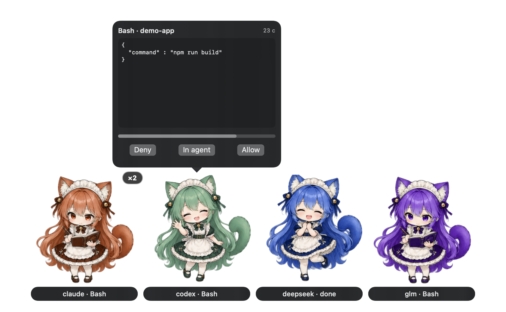

# agent-pet

A floating desktop pet for coding agents. One character per active agent (Claude Code, Codex, DeepSeek Harness, or anything that can run a shell command); her mood follows the agent, and when an agent asks for permission the pet shows the prompt in a bubble you can answer without switching windows.



Pets appear only while a session is working, waiting for you, or just finished. Everything is local: agents append JSON lines to a file and the overlay tails it. Nothing is sent over the network and there are no accounts; the optional DSH plugin opens a loopback-only port (127.0.0.1) for the overlay's open-session commands.

## Requirements

- macOS 14 or later
- Swift 6 toolchain (Xcode or the Command Line Tools)
- Python 3 (ships with macOS; used by the installer)

ChatGPT (the chat app) has no local plugin API, so there is no integration with it. Codex running inside ChatGPT.app is covered by the Codex plugin below.

## Install

```sh
git clone https://github.com/rpegorov/agent-pet.git
cd agent-pet
scripts/install.sh                  # build, install to ~/.local/agent-pet, hook up Claude Code and Codex
scripts/install.sh --launch-agent   # also start the overlay at login
```

`install.sh` also accepts `--no-claude-hooks` and `--no-codex-hooks` (use these with the plugins below), and `--uninstall`.

## Connect your agents

Use **either** the plugin **or** the `install.sh` hooks for a given agent, not both. Both together would deliver every event twice and ask every permission twice; the emitter does not de-duplicate because it cannot tell which hook fired first. Plugins carry only the hook wiring, so run `scripts/install.sh --no-claude-hooks --no-codex-hooks` once for the binary and the overlay.

**Claude Code.** `install.sh` adds hooks to `~/.claude/settings.json`. Or, as a plugin:

```
/plugin marketplace add rpegorov/agent-pet
/plugin install agent-pet@agent-pet
```

**Codex.** `install.sh` adds hooks to `~/.codex/hooks.json` and trusts them in `~/.codex/config.toml`. Or, as a plugin:

```sh
codex plugin marketplace add rpegorov/agent-pet
codex plugin add codex-agent-pet@agent-pet
```

Codex does not trust the plugin's hooks on a command-line install, so they stay silent until you approve them (see Troubleshooting). The `install.sh` route has no such step.

**DeepSeek Harness (DSH).** `plugins/dsh-agent-pet` is a standalone DSH plugin. In your profile's `package.json` add a dependency `"dsh-agent-pet": "link:/path/to/agent-pet/plugins/dsh-agent-pet"` and add `"dsh-agent-pet"` to `dsh.profile.bundles`, install, and restart DSH. It reports session state and lets the overlay open a session or start a chat in the Harness UI.

**Anything else** (scripts, task runners, other agents):

```sh
agent-pet-emit send --agent glm --session task-1 --label "refactor" --mood working
agent-pet-emit send --agent glm --session task-1 --mood complete
```

## Event protocol

`agent-pet-emit` appends one line per event to `~/.agent-pet/events.jsonl` (override with `AGENT_PET_LOG`); the overlay tails the file. The file is rotated to `events.jsonl.1` above 512 KiB.

```json
{"v":1,"agent":"claude","session":"5e9d","mood":"working","label":"Bash","ts":1792276251.42}
```

`mood` is `idle`, `working`, `attention`, `complete` or `ended` (removes the session). `label` is at most 40 characters. Optional fields, omitted when unknown: `cwd`, `app` (bundle id of the hosting app), `tty`, `detail` (permission summary, at most 200 characters), `permission` (id of a pending request).

Decay: working with no event for 120 s is hidden, complete is hidden after 10 s, attention after 10 min, a session silent for 30 min is dropped. An agent's pet shows the highest-priority mood of its live sessions: attention, working, complete.

## Permission bubble

With the overlay running, `agent-pet-emit permit` (the PermissionRequest hook) shows the pending tool call in a bubble with **Deny**, **In agent** and **Allow**, and a countdown.

- The bubble shows the whole tool input (pretty-printed JSON, capped at 8 KiB). If the input is capped or unreadable, Allow is withheld.
- **In agent** hands the prompt back to the agent's own dialog. If nobody answers before the countdown ends (at most 40 s, `AGENT_PET_PERMIT_WAIT` seconds, default 30), or the overlay stops running, the native dialog appears as usual. The pet never auto-allows.
- Tools that ask you something (`AskUserQuestion`, `ExitPlanMode`) are never turned into a bubble.
- Requests live in `~/.agent-pet/permissions/` (owner-only) and are removed when answered, expired or when the hook is killed.
- The overlay's own texts (Deny, In agent, Allow, status labels) are English and not localised; labels that come from agents (tool names, session titles) appear as sent.
- To turn the bubble off, quit the overlay (the hook then stays silent), or change the `PermissionRequest` command from `permit` to `hook` in the agent's hook config.

## Privacy

agent-pet keeps everything on your Mac and sends nothing over the network.

- **What is written.** `~/.agent-pet/events.jsonl` holds one line per hook event: agent name, session id, mood, a short label (tool name, session title or notification text), the working directory, the hosting app's bundle id, the terminal tty and, for permission requests, a summary of the tool call (at most 200 characters). Prompts, tool output and file contents are not recorded.
- **Permission requests.** While a request is pending, `~/.agent-pet/permissions/` holds its full tool input (at most 8 KiB). The file is deleted when the request is answered, expires or the hook is killed; leftovers older than 2 minutes are cleaned up.
- **Access.** The directory is owner-only (0700) and the log is 0600. The log is rotated at 512 KiB, keeping one previous file.
- **What is read.** The overlay reads the event log, and, to open a Claude Desktop session, the session index in `~/Library/Application Support/Claude/claude-code-sessions` (read only). Selecting a Terminal or iTerm2 tab uses AppleScript and asks macOS for Automation permission once.
- **System log.** Clicks and jumps are logged under the subsystem `agent-pet` with agent, session id, app and the opened URL; no tool input or paths.
- **Network.** None outbound. The DSH plugin listens on a loopback-only port and accepts commands only from local processes and the Harness web UI; the overlay talks to it over `127.0.0.1`.

Delete `~/.agent-pet` to remove all recorded data.

## Uninstall

```sh
scripts/install.sh --uninstall
```

Removes the binaries, hooks, trust entries and LaunchAgent. A no-op `agent-pet-emit` stub stays behind so sessions that are still open do not report a missing command; restart them and delete the stub. Plugins are removed with `/plugin uninstall`, `codex plugin remove` or by editing the DSH profile.

## Troubleshooting

- **Nothing appears.** Is the overlay running (`pgrep -x AgentPet`)? Does `~/.agent-pet/events.jsonl` grow when an agent works? If not, the hooks are not installed or the agent was started before they were; restart the agent.
- **Codex plugin hooks do nothing.** Codex 0.163 does not trust hooks from a plugin installed with `codex plugin add`; they ran only with `--dangerously-bypass-hook-trust`. Approve them in Codex (`/hooks`) or use `scripts/install.sh`, which writes the trust entries itself. Re-run `install.sh` after changing a hook command: the trust is tied to its text.
- **DSH changes are not picked up.** DSH caches plugin ES modules; restart it after installing or editing a plugin.
- **DSH commands are refused.** The plugin's bridge answers only the Harness web UI origin (`http://127.0.0.1:50306`) and local processes; a UI served from another origin cannot read its queue.

## License

MIT. The sprite art in `Sources/AgentPet/Resources` is included under the same license.
